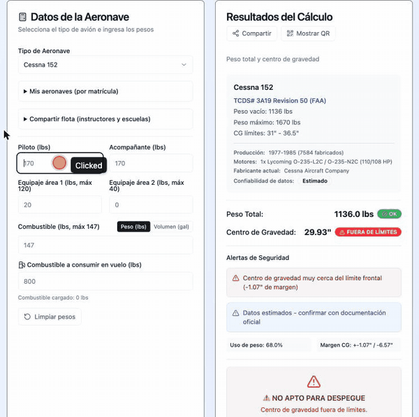

# ✈️ CheckCG - Calculador de Peso y Balance

Aplicación web open source para el cálculo de peso y balance (Weight & Balance) de aeronaves, basada en datos oficiales de la FAA.

[](https://opensource.org/licenses/MIT)

### 🚀 [checkcg.com](https://checkcg.com/)

> Antes publicado como _wb-aviation_ en `wb-aviation.pages.dev` (redirige a checkcg.com).



**Aeronaves soportadas:** King Air E90 · Cessna 172S · Cessna 152 · Piper PA-28-161 Warrior · Piper PA-38 Tomahawk · Tecnam P2008 JC · Tecnam P2002 JF · Diamond DA20-C1 · Diamond DA40 _(próximamente: King Air B200 y Beech 1900D)_

## 📋 Descripción

Esta herramienta permite calcular el peso total y el centro de gravedad (CG) de una aeronave, verificando que se encuentre dentro de los límites operacionales seguros establecidos por el fabricante y la FAA. La aplicación es multi-aeronave y data-driven: el formulario, los cálculos y los gráficos se generan automáticamente a partir de los datos de cada aeronave.

El sistema incluye:

- ✅ Cálculo automático de peso total y centro de gravedad
- ✅ Catálogo de 9 aeronaves con una página por aeronave e idioma
- ✅ Aeronave propia por matrícula, kg/lbs y CG de aterrizaje y sin combustible
- ✅ Hoja de carga imprimible / PDF, link y QR para compartir, modo escuela
- ✅ Validación contra envolvente de CG oficial
- ✅ Sistema de alertas de seguridad y advertencias
- ✅ Visualización gráfica del envolvente de CG
- ✅ Datos verificados con documentación oficial
- ✅ Persistencia local de los datos cargados y la aeronave seleccionada
- ✅ Uso offline (PWA instalable)
- ✅ Trilingüe español/inglés/portugués con selector y detección de idioma del navegador
- ✅ Accesibilidad y manejo global de errores

## 🚀 Características Principales

### Cálculo de Peso y Balance

- Estaciones de carga propias de cada aeronave (tripulación, pasajeros, equipaje, combustible)
- Peso vacío y brazo de ejemplo del POH, o los de tu avión con "Mis aeronaves"
- Fases de vuelo: despegue, aterrizaje (según combustible consumido) y sin combustible

### Sistema de Validación

- Verificación de peso máximo de despegue (y de aterrizaje / sin combustible si están declarados)
- Validación de límites de CG de cada aeronave
- Algoritmo de punto en polígono para envolvente irregular
- Márgenes de seguridad configurables

### Alertas de Seguridad

- **Advertencias de peso**: Alerta cuando se acerca al 95% del peso máximo
- **Advertencias de CG**: Notificación de proximidad a límites frontales/posteriores
- **Recomendaciones**: Sugerencias de ajustes para mayor seguridad
- **Confiabilidad de datos**: Indicadores de verificación de información

### Visualización Gráfica

- Gráfico interactivo del envolvente de CG
- Representación del punto operativo actual
- Líneas de referencia de límites
- Tooltips informativos

## 🛠️ Tecnologías Utilizadas

- **React 19.1.1** - Framework UI
- **Astro 7** - Sitio estático (páginas por idioma y aeronave para SEO) con la app React como isla
- **Vite 8** - Build tool (vía Astro)
- **Tailwind CSS 4.1.12** - Framework de estilos
- **Recharts 3.1.2** - Librería de gráficos
- **Lucide React 0.540.0** - Sistema de iconos
- **@vite-pwa/astro + vite-plugin-pwa** - Soporte PWA / offline
- **@astrojs/sitemap** - `sitemap-index.xml` con alternates hreflang
- **Vitest 4.x + Testing Library** - Tests unitarios y de componentes
- **ESLint 9.33.0 + Prettier** - Linter y formateo de código

La interfaz usa un módulo de i18n (`src/i18n/`) para centralizar los textos; disponible en **español, inglés y portugués**, con resolución automática por idioma del navegador y selector manual persistido. Para sumar un idioma: crear `src/i18n/<locale>.js` y registrarlo en `src/i18n/index.js`.

## 📦 Instalación

```bash
# Clonar el repositorio
git clone https://github.com/PabloAlaniz/wb-aviation.git

# Navegar al directorio
cd wb-aviation

# Instalar dependencias
npm install
```

## 🚀 Uso

### Modo Desarrollo

```bash
npm run dev
```

Inicia el servidor de desarrollo en `http://localhost:4321`

### Build de Producción

```bash
npm run build
```

Genera la versión optimizada en la carpeta `dist/`

### Preview de Producción

```bash
npm run preview
```

Previsualiza el build de producción localmente

### Tests

```bash
npm test              # Ejecuta los tests una vez
npm run test:watch    # Modo watch
npm run test:coverage # Reporte de cobertura
```

### Linting y Formato

```bash
npm run lint          # ESLint
npm run typecheck     # Chequeo de tipos con TypeScript (checkJs)
npm run format        # Formatea el código con Prettier
npm run format:check  # Verifica formato (usado en CI)
```

### Variables de entorno

Copiá `.env.example` a `.env.local` para habilitar integraciones opcionales (prefijo `PUBLIC_`; también se acepta el prefijo heredado `VITE_`):

- `PUBLIC_PLAUSIBLE_DOMAIN` (o `VITE_PLAUSIBLE_DOMAIN`) — dominio del sitio en [Plausible](https://plausible.io) para activar analytics sin cookies. Si queda vacío, no se carga ningún script de métricas.

## 📂 Estructura del Proyecto

```
wb-aviation/
├── src/
│   ├── components/         # Componentes de UI
│   │   ├── AircraftInfo.jsx     # Resumen y metadata de la aeronave
│   │   ├── Badge.jsx            # Badge/etiqueta
│   │   ├── Card.jsx             # Tarjeta
│   │   ├── CGEnvelopeChart.jsx  # Gráfico de envolvente CG
│   │   ├── DataSources.jsx      # Referencias y fuentes oficiales
│   │   ├── Input.jsx            # Input personalizado
│   │   ├── ResultsPanel.jsx     # Resultados y veredicto de despegue
│   │   ├── SafetyAlerts.jsx     # Alertas de seguridad
│   │   ├── Select.jsx           # Select personalizado
│   │   ├── Separator.jsx        # Separador visual
│   │   ├── StationForm.jsx      # Formulario de carga (data-driven)
│   │   └── *.test.jsx           # Tests de componentes
│   ├── data/
│   │   ├── aircraft.js          # Base de datos de aeronaves
│   │   └── aircraft.test.js     # Tests de integridad de datos
│   ├── hooks/
│   │   └── useLocalStorage.js   # Persistencia en localStorage
│   ├── i18n/
│   │   ├── es.js                # Textos en español
│   │   └── index.js             # Resolución de locale
│   ├── utils/
│   │   ├── calculations.js      # Lógica de cálculo W&B
│   │   └── calculations.test.js # Tests unitarios
│   ├── layouts/Base.astro # <head> SEO (canonical, hreflang, OG, JSON-LD), PWA y analytics
│   ├── pages/             # Rutas Astro: /, /{es,en,pt}/ y /{es,en,pt}/{aeronave}/
│   ├── App.jsx            # Componente principal (composición)
│   └── components/AppIsland.jsx # Isla React (client:only) montada por las páginas
├── docs/                  # Documentación (datos de aeronave, métricas), demo y PDFs
├── public/                # Recursos estáticos
├── data/                  # Imágenes de referencia del TCDS
├── package.json           # Dependencias y scripts
├── astro.config.mjs       # Configuración de Astro (i18n, sitemap, PWA, Tailwind)
├── vitest.config.js       # Configuración de Vitest
├── eslint.config.js       # Configuración de ESLint
└── README.md             # Este archivo
```

## ✈️ Aeronaves

Cada aeronave tiene su página con estaciones, envolvente, fuentes y FAQ en [checkcg.com](https://checkcg.com/es/).

| Aeronave                 | TCDS          | Peso máx. (lbs) | Confiabilidad | Página                                                 |
| ------------------------ | ------------- | --------------- | ------------- | ------------------------------------------------------ |
| King Air E90             | FAA 3A20      | 10,100          | verificado    | [es](https://checkcg.com/es/king-air-echo-90/)         |
| Cessna 172S Skyhawk      | FAA 3A12      | 2,550           | estimado      | [es](https://checkcg.com/es/cessna-172s/)              |
| Cessna 152               | FAA 3A19      | 1,670           | estimado      | [es](https://checkcg.com/es/cessna-152/)               |
| Piper PA-28-161 Warrior  | FAA 2A13      | 2,440           | parcial       | [es](https://checkcg.com/es/piper-pa-28-161-warrior/)  |
| Piper PA-38-112 Tomahawk | FAA A18SO     | 1,670           | parcial       | [es](https://checkcg.com/es/piper-pa-38-112-tomahawk/) |
| Tecnam P2008 JC          | EASA.A.583    | 1,388           | estimado      | [es](https://checkcg.com/es/tecnam-p2008-jc/)          |
| Tecnam P2002 JF          | EASA.A.006    | 1,278           | estimado      | [es](https://checkcg.com/es/tecnam-p2002-jf/)          |
| Diamond DA20-C1          | EASA.IM.A.223 | 1,653           | estimado      | [es](https://checkcg.com/es/diamond-da20-c1/)          |
| Diamond DA40 (IO-360)    | EASA.IM.A.022 | 2,535           | estimado      | [es](https://checkcg.com/es/diamond-da40-180/)         |

> ⚠️ El peso vacío y su brazo son valores de ejemplo: usá siempre el Weight & Balance Report de tu aeronave (función "Mis aeronaves").
> Fuentes, supuestos y puntos pendientes de cada modelo: `metadata` en [`src/data/aircraft.js`](src/data/aircraft.js) y [docs/aircraft-data.md](docs/aircraft-data.md).

## ⚠️ Advertencias Importantes

### Disclaimer Legal

**IMPORTANTE**: Esta herramienta es de **referencia general** y no sustituye la documentación oficial de la aeronave.

- ⚠️ Los datos de peso vacío y brazo de cada modelo son **valores de ejemplo** del POH/AFM
- ⚠️ **Cada aeronave individual** tiene su propio Weight & Balance Report que debe consultarse
- ⚠️ Siempre verificar con el **Weight & Balance Report específico** de su aeronave
- ⚠️ Esta calculadora NO reemplaza los procedimientos operacionales oficiales
- ⚠️ NO utilizar para cálculos operacionales sin verificación oficial

### Uso Recomendado

- Planificación preliminar de vuelos
- Educación y entrenamiento
- Verificación cruzada de cálculos manuales
- Estudio de envolventes de CG

### Seguridad Operacional

Para operaciones reales de vuelo:

1. Consultar el Weight & Balance Report de su aeronave específica
2. Verificar los datos con la documentación oficial vigente
3. Seguir los procedimientos del manual de operaciones (AFM/POH)
4. Cumplir con todas las regulaciones aeronáuticas aplicables

## 🔧 Configuración

### Variables de Aeronave

Los datos de las aeronaves están centralizados en `src/data/aircraft.js`. Para agregar nuevas aeronaves o variantes, seguir la guía en [docs/aircraft-data.md](docs/aircraft-data.md) — el formulario, los cálculos y el gráfico se generan automáticamente a partir de los datos.

### Factores de Seguridad

```javascript
safetyFactors: {
  weightMargin: 0.95,        // 95% del peso máximo = alerta
  cgMargin: 0.1,             // 0.1" de margen en límites CG
  recommendedReserve: {
    fuel: 200,               // lbs de combustible de reserva
    weight: 200              // lbs de margen de peso
  }
}
```

## 📊 Algoritmo de Validación

El sistema utiliza un algoritmo de **ray casting** (punto en polígono) para determinar si el CG está dentro del envolvente irregular:

```javascript
// Verifica si punto (cg, weight) está dentro del polígono del envolvente
isPointInEnvelope(cg, weight, envelopePoints)
```

## 🤝 Contribuciones

Las contribuciones son bienvenidas, especialmente para:

- Agregar aeronaves con datos verificables (ver [CONTRIBUTING.md](CONTRIBUTING.md))
- Mejorar visualizaciones
- Agregar más validaciones de seguridad
- Traducción a otros idiomas
- Mejoras en la documentación

## 📝 Licencia

Este proyecto es de código abierto. Verificar archivo LICENSE para más detalles.

## 📞 Soporte

Para preguntas técnicas o reportar problemas, abrir un issue en el repositorio.

---

## 🗺️ Roadmap

Ver [ROADMAP.md](ROADMAP.md). Las métricas que recolecta el sitio y su política de privacidad están en [docs/analytics.md](docs/analytics.md).

---

**Desarrollado para la comunidad aeronáutica** 🛩️
